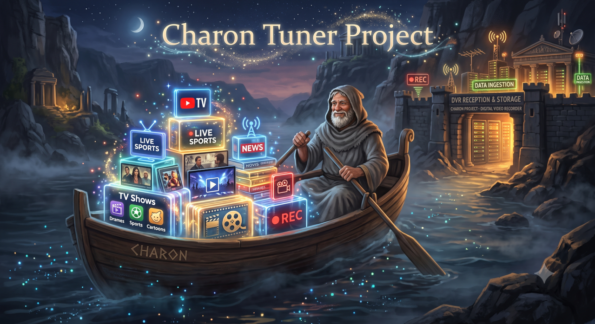

<kbd>
  
</kbd>

# Credits

- **Spectrum Provider:** Built off of `spectrum.py` from the great work of **Kineticman** ([FastChannels](https://github.com/kineticman/FastChannels)).
- **Xfinity and Sling Providers:** Developed by **bnhf** ([https://github.com/bnhf](https://github.com/bnhf)).

---

# Charon

Charon is a C# browser-based tuner bridge designed to manage, tune, and stream live television from web-based media providers directly into any client supporting M3U playlists and MPEG-TS streams.

## Features

- **Multi-Tuner Virtual Tuner Pool:** Supports up to 4 simultaneous concurrent virtual browser tuners with off-screen window placement and GPU/DWM window-staggering to prevent compositor occlusion and resource contention.
- **Out-of-the-Box Provider Modules:** Pre-configured support for **YouTube TV**, **Spectrum TV**, **Xfinity**, **Sling TV**, and **Philo**, complete with custom CSS styling, automated unmuting, full-bleed viewport locks, and channel tuning scripts.
- **Embedded Web Management Dashboard:** Complete remote control accessible from any browser at `http://<IP>:48590`—allowing lineup editing, setting adjustments, log monitoring, and lineup scans without accessing the host machine directly.
- **Interactive Channel Lineup Editor:** Built-in DataGrid and Raw JSON editor for `channels.json` with inline channel searching, bulk hide/show toggles, channel renumbering, and custom Gracenote station ID mapping.
- **Automated Guide Matching (Gracenote / TMS):** Automated scraping and integration with your local Channels DVR server to automatically match web channels to Gracenote Station IDs.
- **Master Authentication Sync:** Log in once on Tuner 1, and Charon will automatically replicate authentication tokens and session cookies across Tuners 2–4.
- **Low-Latency Direct Capture Pipeline:** Captures tab audio and video directly through Chrome's tab capture engine into an asynchronous in-memory channel queue, delivering MPEG-TS streams via FFmpeg passthrough with zero double-encoding.
- **System Tray Background Daemon:** Minimizes to the Windows System Tray with a right-click quick menu, keeping the streaming server active in the background when the main window is closed.

---

### Step 1: Download and Install Charon

1. Visit the official GitHub releases page: **[https://github.com/nuken/Charon/releases](https://github.com/nuken/Charon/releases)**.
2. Download the latest release package.
3. Extract or run the application installer on your Windows host machine.
4. **Prerequisites:** Ensure [Google Chrome](https://www.google.com/chrome/) is installed on the host machine. Charon automatically locates your Chrome installation and local FFmpeg binary.

---

### Step 2: Choosing Your Provider

Charon supports five major streaming providers out of the box:

1. Launch **Charon** (or navigate to `http://<HOST-IP>:48590` on any device on your LAN).
2. Look at the provider selection dropdown near the top of the interface.
3. Select your streaming provider:
   - **YouTube TV**
   - **Spectrum TV**
   - **Xfinity**
   - **Sling TV**
   - **Philo**

---

### Step 3: Logging In to Your Provider (Single Sign-On Sync)

Before tuning or scanning channels, Charon needs an active session:

1. Select your target provider from the dropdown menu.
2. Set the login target to **"Tuner 1 (Sync All)"** (or use the web dashboard's login trigger).
3. Click **"1. Login to Provider"**.
4. A visible Chrome window will open to the provider's sign-in page (`tv.youtube.com`, `watch.spectrum.net`, `xfinity.com/stream`, `watch.sling.com`, or `philo.com`).
5. Sign in to your account and verify that live video plays cleanly and without prompts.
   - **Sling TV:** When the **Who's Watching?** screen appears, click **Don't Ask Again** so tuners go straight to the channel. (If it still appears, Charon selects the first profile automatically.)
6. **Close that Chrome login window completely.** Charon will automatically replicate your session cookies and authentication state across Tuners 2, 3, and 4.

---

### Step 4: Scanning and Loading `channels.json`

Once authenticated, pull your live channel lineup directly into Charon:

1. Click the **"2. Scan & Sync Lineup"** button.
2. **Behavior by Provider:**
   - **Spectrum TV:** Charon scans your entitled channel lineup directly. Spectrum provides native Gracenote Station IDs (`tmsid`) in its lineup API, so it saves the lineup immediately without external prompts.
   - **Sling TV:** Charon reads every channel in your Sling A-Z guide. Channels from your subscriptions are visible, and Sling's free **Freestream** channels are added **hidden**. Unhide any you want and scan again to match their Gracenote IDs; hidden channels are skipped during Gracenote matching.
   - **Philo:** Charon reads Philo's full channel guide. Channels in your Philo subscription are visible, and Philo's **Free channels** are added **hidden**. Unhide any you want and scan again to match their Gracenote IDs. Tuning a Philo channel jumps straight to the live broadcast (Philo otherwise starts the current show from the beginning).
   - **YouTube TV, Xfinity, Sling TV & Philo:** Charon will prompt for your **Channels DVR Server IP and Port** (default: `8089`). It scrapes your live provider guide grid via the Chrome DevTools Protocol and automatically queries your Channels DVR server to match and populate Gracenote `StationId` values for your local market.
3. When complete, a summary dialog will display the total scraped channels and successfully mapped Gracenote IDs.

---

### Step 5: Managing Your Lineup & M3U Playlist

You can fine-tune your channel lineup using either the native desktop interface or the web dashboard (`http://<IP>:48590`):

- **Hide / Show Channels:** Use the **Hide** checkboxes to exclude unwanted channels (shopping channels, music loops, foreign language tiers) from your generated playlist.
- **Gracenote ID Adjustments:** Manually enter or update any missing `StationId` values directly in the table.
- **Add / Remove Channels:** Manually add custom stream URLs or delete deprecated channels.
- **Raw JSON Editor:** Switch to the **Raw JSON** tab to import, export, or paste `channels.json` configurations directly.
- **Saving:** Click **"Save Lineup"** to commit your changes. Your M3U playlist updates immediately at `http://<IP>:48590/playlist.m3u`.

---

### Step 6: Integrating with Channels DVR

1. Open your **Channels DVR Web Admin** interface (`http://<DVR-IP>:8089`).
2. Navigate to **Settings** > **Add Source** > **Custom Channels**.
3. Configure your source:
   - **Source Name:** `Charon`
   - **Stream Format:** `MPEG-TS`
   - **Source:** Select `URL` and enter: `http://<CHARON-IP>:48590/playlist.m3u`
   - *Optional:* To include only specific providers, add a `provider` filter using the provider ID(s) from each provider's `provider.json`, comma separated — e.g. `http://<CHARON-IP>:48590/playlist.m3u?provider=xfinity` or `?provider=xfinity,youtubetv`. This lets you create a separate Channels DVR source per provider.
   - **XMLTV Guide Data:** Leave blank (Gracenote IDs in the M3U will map guide data automatically).
   - **Max Connections:** Match your configured Charon tuner limit (e.g., `1` to `4`).
4. Click **Save**. Channels DVR will automatically index your lineup and download guide data.

---

### Step 7: Fixing Missing or Custom Guide Data

Because web streaming providers frequently use local station brand names rather than FCC callsigns, automated matching resolves roughly 95% of channels:

1. In Channels DVR, open your Charon source and click **Manage Lineup**.
2. Locate any channels with missing or incorrect guide mappings.
3. Click the **+** (search) icon next to the channel, type in your local call sign or network name, and select the match. Channels DVR locks and preserves this mapping across guide refreshes.

---

### Performance & Headless Server Recommendations

- **HDMI Dummy Plug:** If running Charon on a headless machine or mini PC, plug in an HDMI display emulator set to **1280x720** (or **1920x1080**) at **59.94 Hz Progressive** with **100% DPI Scaling**. This keeps the Windows Desktop Window Manager (DWM) hardware compositing at broadcast-accurate frame rates without sleeping.
- **Resolution Setting:** Use **720p** for optimal multi-tuner stability and fast channel tune times (`~2–3s`). Switch to **1080p** if your host system has ample RAM and GPU hardware-encoding headroom.
