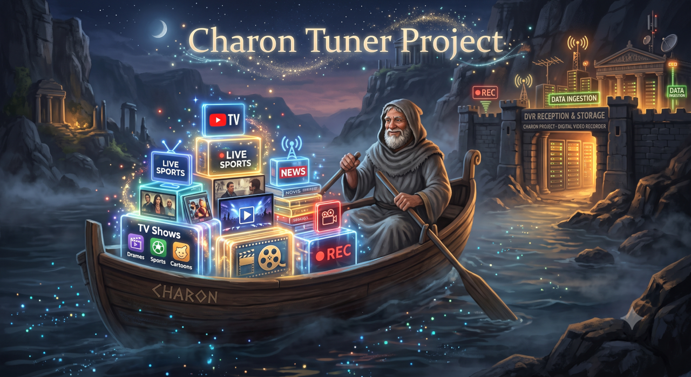

  

# Charon

Charon is a C# desktop application designed to manage, tune, and stream content from web-based media providers.

## Features

* Built with C# and WPF for the Windows desktop interface.
* Includes an automated Chrome tuner implementation for handling browser-based streams.
* Features a built-in server component for managing connections.
* Supports modular providers such as YouTube TV with custom channel listings and styling.
* Process audio tapping capabilities to capture and handle stream audio.
